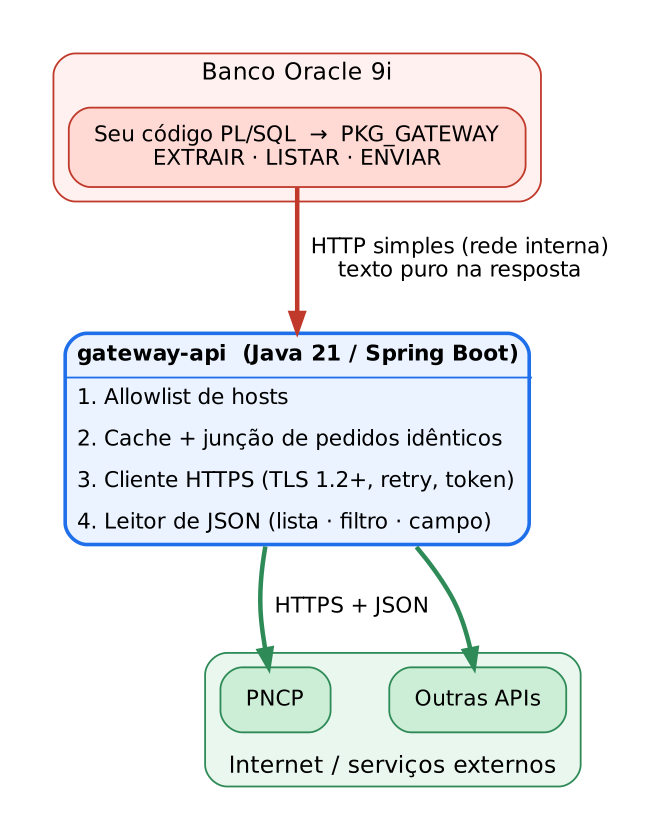
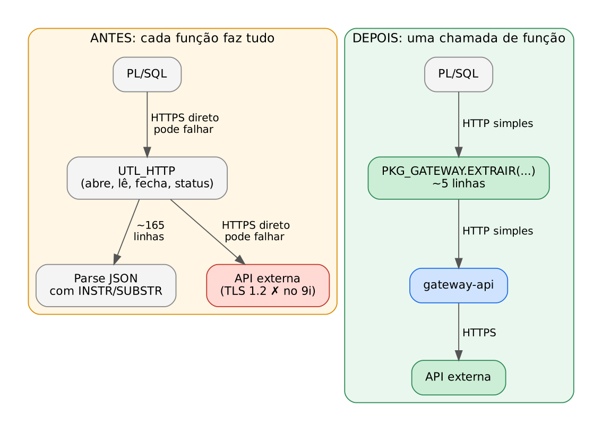
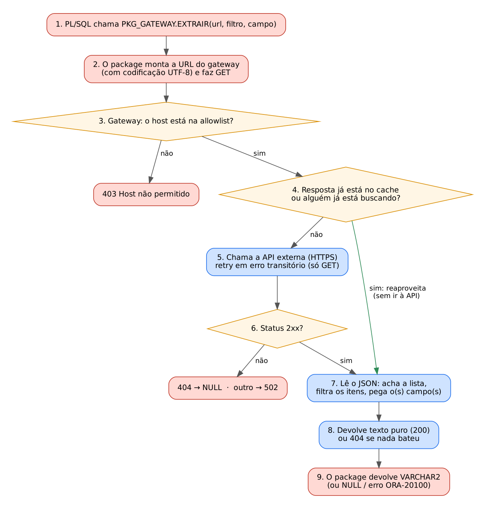
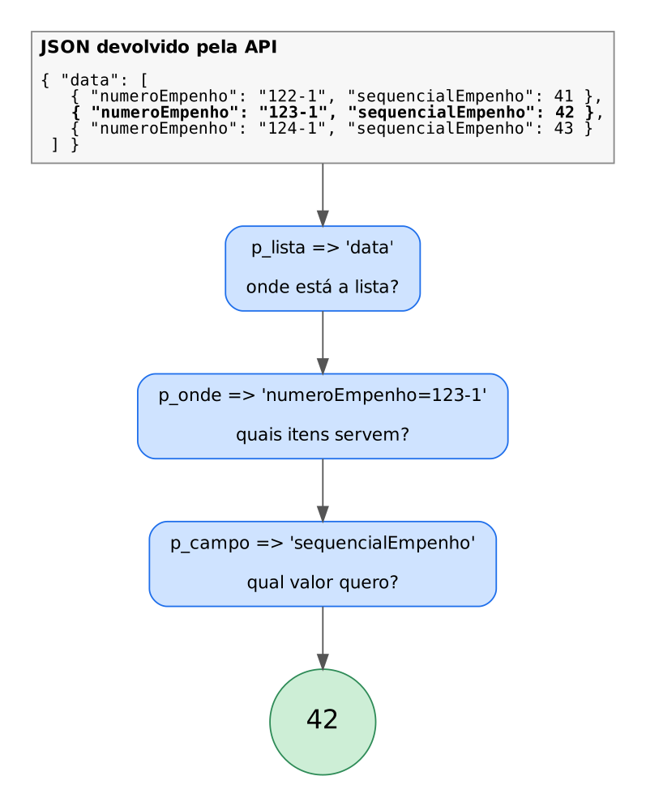
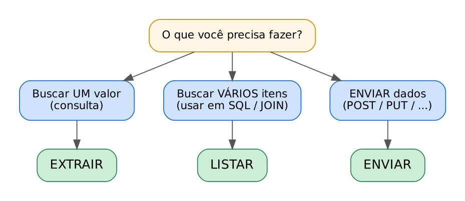
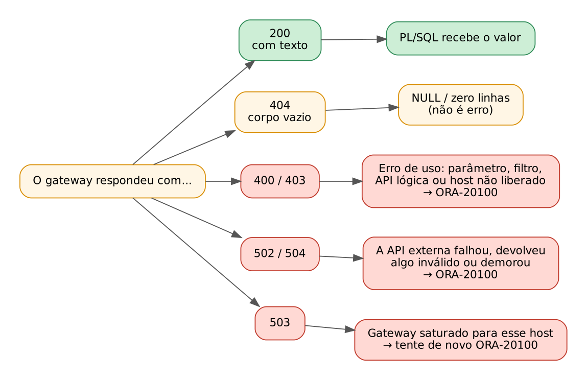
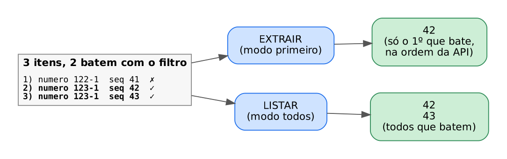
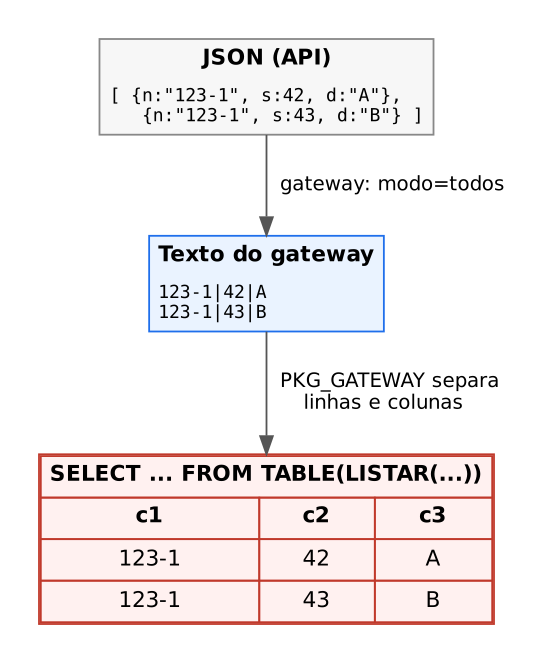
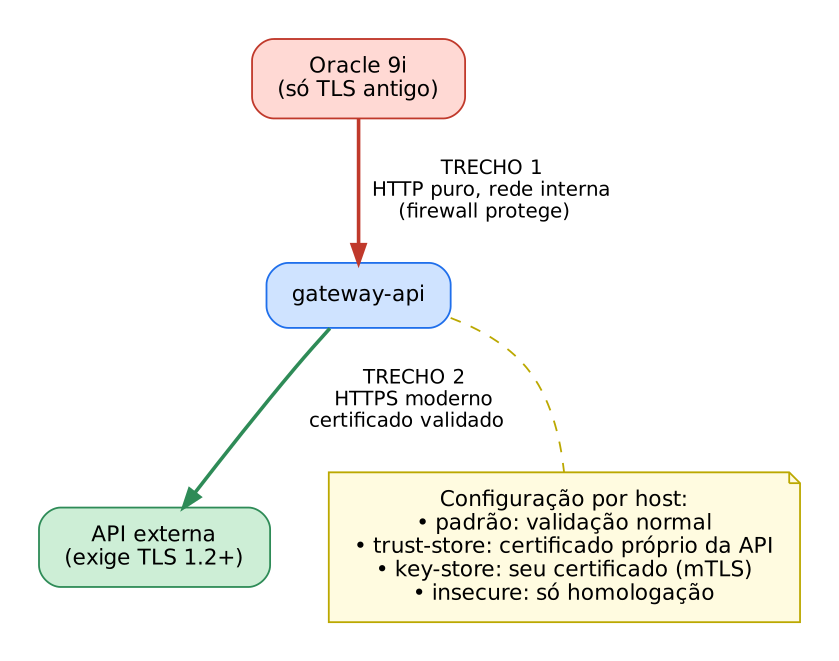
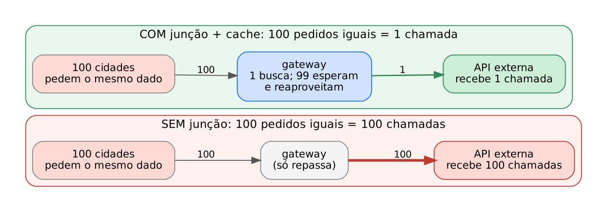

# Manual completo do gateway-api

**Como consumir APIs modernas (PNCP e outras) a partir do Oracle PL/SQL 9i, sem escrever HTTP nem parse de JSON na mão.**

Este manual é para **qualquer programador**: não é preciso conhecer o gateway, Java ou JSON a fundo.
Ele explica **o que é**, **como funciona**, **por que funciona**, **como usar**, **o que pode dar
errado** e **como evitar**.

---

## Sumário

1. [Visão geral](#1-visão-geral)
2. [Conceitos básicos (para qualquer programador)](#2-conceitos-básicos-para-qualquer-programador)
3. [Como funciona](#3-como-funciona)
4. [Instalação](#4-instalação)
5. [Configuração do gateway](#5-configuração-do-gateway)
6. [Usando no PL/SQL](#6-usando-no-plsql)
7. [Listas e mais de uma ocorrência](#7-listas-e-mais-de-uma-ocorrência)
8. [SSL/TLS e certificados](#8-ssltls-e-certificados)
9. [Autenticação e credenciais](#9-autenticação-e-credenciais)
10. [Desempenho e muitas cidades ao mesmo tempo](#10-desempenho-e-muitas-cidades-ao-mesmo-tempo)
11. [Problemas comuns e como evitá-los](#11-problemas-comuns-e-como-evitá-los)
12. [Diagnóstico passo a passo](#12-diagnóstico-passo-a-passo)
13. [Segurança](#13-segurança)
14. [Exemplo completo: migrando o caso do empenho](#14-exemplo-completo-migrando-o-caso-do-empenho)
15. [Referência](#15-referência)
16. [Perguntas frequentes](#16-perguntas-frequentes)
17. [Limitações e o que foi verificado](#17-limitações-e-o-que-foi-verificado)
18. [Glossário](#18-glossário)

---

## 1. Visão geral

### 1.1 O problema

Os sistemas em Oracle PL/SQL 9i precisam consumir APIs modernas, como a do PNCP. Isso traz duas
dificuldades grandes:

1. **O 9i não consegue falar com APIs modernas de forma confiável.** Ele só conhece versões antigas
   de TLS (a criptografia do HTTPS). APIs atuais exigem TLS 1.2 ou superior e podem simplesmente
   recusar a conexão.
2. **O 9i não entende JSON.** Não existe `JSON_TABLE`, `JSON_VALUE` nem `APEX_JSON`. Para ler uma
   resposta, o programador acabava usando `INSTR`/`SUBSTR` para "caçar" texto dentro do JSON, o que
   gera funções enormes e frágeis.

O resultado era um "rolo": cada API nova trazia ~165 linhas de código quase igual (abrir conexão,
ler resposta em pedaços, tratar erro, procurar `{` e `}` no texto...).

### 1.2 A solução

Um serviço pequeno, o **gateway-api**, fica entre o Oracle e as APIs externas:



- Para o **Oracle**, o gateway é simples: HTTP puro (sem criptografia moderna), parâmetros na URL e
  respostas em **texto puro**.
- Para a **API externa**, o gateway é um cliente moderno: HTTPS com TLS atual, autenticação, retry,
  leitura correta de JSON.

### 1.3 Antes e depois



```sql
-- DEPOIS: toda a lógica de HTTP + JSON some do seu código
v_seq := TO_NUMBER(PKG_GATEWAY.EXTRAIR(
             p_url   => V_URL,
             p_onde  => 'numeroEmpenho=123-1',
             p_campo => 'sequencialEmpenho'));
```

### 1.4 Quando usar e quando não usar

| Use o gateway quando... | Não use quando... |
|---|---|
| O Oracle 9i precisa chamar uma API HTTPS/JSON | Você consegue chamar a API direto e o banco tem JSON nativo (Oracle 12c+) |
| Quer ler um valor ou uma lista de uma resposta JSON | A resposta não é JSON (XML/SOAP, binário, PDF) |
| Quer enviar dados (POST) para uma API | A autenticação exige um fluxo muito específico (assinatura digital, OAuth interativo) sem conector no gateway |
| Várias cidades/sistemas consultam as mesmas APIs | Precisa de respostas maiores que ~32 mil caracteres no Oracle 9i |

---

## 2. Conceitos básicos (para qualquer programador)

Se você já conhece estes termos, pode pular para a seção 3.

**API.** Um endereço na internet que, quando chamado, devolve dados (e não uma página bonita).
Ex.: `https://pncp.gov.br/...` devolve dados de contratações.

**HTTP e HTTPS.** O "idioma" das chamadas na web. HTTPS é o mesmo idioma **com criptografia**.

**TLS.** A criptografia usada pelo HTTPS. Tem versões (1.0, 1.1, 1.2, 1.3). Versões antigas são
consideradas inseguras e muitas APIs não aceitam mais. O Oracle 9i só sabe as antigas.

**GET e POST.** Dois tipos de chamada. **GET** = "me dê este dado" (consulta). **POST** = "receba
este dado" (envio). Existem também PUT, PATCH e DELETE.

**JSON.** Um formato de texto para dados estruturados. Exemplo:

```json
{ "numeroEmpenho": "123-1", "sequencialEmpenho": 42, "itens": [ { "id": 1 }, { "id": 2 } ] }
```

- `{ ... }` é um **objeto** (conjunto de pares `chave: valor`).
- `[ ... ]` é uma **lista** (array) de itens.
- Valores podem ser texto (`"abc"`), número (`42`), `true`/`false` ou `null`.
- Objetos e listas podem ficar **dentro** de outros (aninhados).

**Código de status HTTP.** Um número que diz como a chamada foi: `200` ok, `404` não encontrado,
`401` sem permissão, `500` erro no servidor, etc.

**Timeout.** Tempo máximo de espera por uma resposta.

**Allowlist.** Lista de itens permitidos; tudo que não está nela é bloqueado.

**Cache.** Guardar uma resposta por pouco tempo para não ter que buscá-la de novo.

**Threads virtuais.** Recurso do Java 21 que permite atender milhares de pedidos ao mesmo tempo
gastando pouquíssima memória enquanto se espera pela rede.

---

## 3. Como funciona

### 3.1 O caminho de uma chamada



Em palavras:

1. **O PL/SQL** chama `PKG_GATEWAY.EXTRAIR`, informando a URL da API externa, o filtro e o campo.
2. **O package** monta a URL do gateway (codificando acentos e símbolos em UTF-8) e faz um GET.
3. **O gateway confere a allowlist.** Host não liberado = erro 403.
4. **Cache e junção:** se a resposta já foi buscada há pouco, ou outro pedido idêntico está em
   andamento, o gateway reaproveita (sem ir à API).
5. **Chamada externa:** HTTPS moderno, com os headers da API lógica (ex.: token) e retry se der erro
   transitório (só GET).
6. **Status:** 2xx segue; `404` vira "não encontrado"; outros viram erro `502`.
7. **Leitura do JSON:** acha a lista, filtra os itens e extrai o(s) campo(s).
8. **Resposta em texto puro:** o valor (200) ou vazio com 404 se nada bateu.
9. **O package** devolve um `VARCHAR2`, `NULL` ou levanta `ORA-20100`.

### 3.2 Como o gateway lê o JSON

Você diz **onde está a lista**, **qual item quer** e **qual valor**:



| Parâmetro | Pergunta que responde | Exemplo |
|---|---|---|
| `p_lista` | Onde está a lista dentro do JSON? | `data` (vazio se a raiz já é a lista) |
| `p_onde` | Quais itens me interessam? | `numeroEmpenho=123-1` |
| `p_campo` | Qual valor devolver? | `sequencialEmpenho` |

### 3.3 Por que isso funciona (e o `INSTR` não)

O código antigo procurava `{` e `}` como texto. Isso quebra, por exemplo, quando:

- o JSON tem objetos **dentro** de objetos (o primeiro `}` encontrado não é o fim do objeto certo);
- um texto contém `}` ou `{` dentro de aspas (`"obs": "valor com } dentro"`);
- há espaços ou quebras de linha em lugares inesperados.

O gateway usa uma **biblioteca de JSON de verdade (Jackson)**, que entende a estrutura completa.
Resolve de uma vez, para qualquer API, em vez de reescrever a lógica para cada uma.

E o problema do TLS some porque o Oracle fala só com o gateway, **em HTTP puro dentro da rede
interna**. Quem fala TLS moderno com a internet é o gateway (Java 21), que sempre está atualizado.

### 3.4 Escolhendo a função



| Função | Para quê | Devolve |
|---|---|---|
| `EXTRAIR` | Um valor (consulta GET) | `VARCHAR2` (ou `NULL` se não achou) |
| `LISTAR` | Vários itens, usados em SQL | Tabela (`TABLE(...)`) com colunas `c1`..`c10` |
| `ENVIAR` | Mandar dados (POST/PUT/PATCH/DELETE) | `VARCHAR2`: campo da resposta ou a resposta inteira |

---

## 4. Instalação

### 4.1 O gateway (uma vez, pela infraestrutura)

Requisito: **Java 21**.

```bash
mvn package
java -jar target/gateway-api-0.1.0.jar
curl http://servidor-gateway:8080/saude        # deve responder: OK
```

Ou com Docker (veja o `Dockerfile` na raiz do projeto). Para usar um `application.yml` próprio, coloque
em `/app/config/application.yml` (veja a seção 5).

> **Rede:** coloque o gateway **somente na rede interna**, atrás de firewall (veja a seção 13).

### 4.2 O lado Oracle (uma vez por banco)

```sql
@oracle/01_tipos.sql
@oracle/02_pkg_gateway.sql
```

Antes de rodar o segundo, abra o arquivo e ajuste o endereço do gateway:

```sql
C_BASE CONSTANT VARCHAR2(200) := 'http://servidor-gateway:8080';
```

O usuário do banco precisa de `EXECUTE` em `UTL_HTTP`. No Oracle 9i não existe ACL de rede (ela só
surgiu no 11g), então, em geral, isso basta.

### 4.3 Teste rápido sem Oracle (com `curl`)

Antes de mexer no PL/SQL, valide a chamada direto no gateway:

```bash
curl -G "http://servidor-gateway:8080/extrair" \
  --data-urlencode "url=https://pncp.gov.br/api/..." \
  --data-urlencode "onde=numeroEmpenho=123-1" \
  --data-urlencode "campo=sequencialEmpenho"
```

Se devolver `42`, o gateway e a API estão certos. Só então teste pelo Oracle.

---

## 5. Configuração do gateway

Arquivo `application.yml`. **Alterou algo? Reinicie o gateway.**

### 5.1 Liberar uma API externa (obrigatório)

O gateway **só chama hosts da lista**. Qualquer outro recebe erro 403.

```yaml
gateway:
  allowed-hosts:
    - pncp.gov.br
    - viacep.com.br
    - api.outra.gov.br
```

Regras:

- Nome do host **sem** `https://`, sem porta e sem caminho (o gateway ignora maiúsculas/minúsculas).
- Só o **host** é conferido (a URL pode ter qualquer caminho).
- Um host que tenha opções de SSL em `gateway.hosts` (seção 8) também é considerado liberado.
- Para liberar uma API nova, é só incluir uma linha aqui e reiniciar.

### 5.2 Todas as opções

```yaml
gateway:
  connect-timeout-seconds: 10     # tempo para conectar na API externa
  read-timeout-seconds: 60        # tempo para a API externa responder
  retry-max: 2                    # tentativas EXTRAS em erro transitório (só GET)
  retry-backoff-ms: 500           # pausa entre tentativas (500, 1000, ...)
  max-items: 500                  # máximo de linhas em modo=todos
  max-response-bytes: 5000000     # resposta externa maior que isso = erro 502

  cache-ttl-seconds: 30           # quanto tempo um GET fica em cache (0 = desliga)
  cache-max-ttl-seconds: 300      # teto do p_cache pedido pelo Oracle
  cache-max-entries: 5000         # tamanho máximo do cache
  max-concurrent-per-host: 100    # chamadas simultâneas por API externa
  queue-timeout-seconds: 10       # espera na fila antes de devolver 503

  allowed-hosts: [ ... ]          # allowlist (seção 5.1)
  hosts: { ... }                  # opcional: opções de SSL por host (seção 8)
  apis:  { ... }                  # APIs lógicas com token (seção 9)
```

Há também, no mesmo arquivo, `server.tomcat.max-connections` e `spring.threads.virtual.enabled`
(já configurados para alta concorrência; veja a seção 10).

---

## 6. Usando no PL/SQL

### 6.1 Um valor: `EXTRAIR`

```sql
v_seq := PKG_GATEWAY.EXTRAIR(
             p_url   => 'https://pncp.gov.br/api/...',
             p_onde  => 'numeroEmpenho=123-1',
             p_campo => 'sequencialEmpenho');
```

- Achou: devolve o valor **como texto**. Converta com `TO_NUMBER`/`TO_DATE` se precisar.
- **Não achou: devolve `NULL`.** Não é erro.
- Problema na chamada: levanta `ORA-20100` com a mensagem do gateway.

> **Atenção:** os parâmetros opcionais vêm antes de `p_campo`, então use sempre **notação nomeada**
> (`p_url => ...`), como nos exemplos.

### 6.2 Filtros (`p_onde`)

Formato `campo=valor`. Vários filtros separados por `;` (**todos** precisam bater):

```sql
p_onde => 'ano=2026;tipo=O'
```

- A comparação é de **igualdade**, como texto, sem espaços nas pontas. Não existe `>`, `<`, `LIKE` ou OR.
- Números funcionam: `id=2` casa com `"id": 2` e com `"id": "2"`.
- O campo do filtro aceita caminho: `fornecedor.cnpj=12345678000199`.
- Sem `p_onde`: vale o primeiro item da lista (ou todos, em `LISTAR`).

### 6.3 Onde está a lista (`p_lista`)

Se a resposta é uma lista direta, `[ {...}, {...} ]`, **não informe** `p_lista`. Se vem dentro de outro
campo, `{ "data": [ ... ] }`, informe o caminho:

```sql
p_lista => 'data'
p_lista => 'resultado.itens'          -- mais níveis, separados por ponto
```

Se o caminho aponta para um **único objeto** (não uma lista), ele é tratado como uma lista de um item.

### 6.4 Caminhos para campos aninhados (`p_campo`)

Use ponto para entrar em objetos e número (começando em 0) para posição em listas:

```sql
p_campo => 'fornecedor.razaoSocial'
p_campo => 'itens.0.valor'            -- valor do primeiro item da lista "itens"
```

Como o JSON de exemplo `{"fornecedor":{"razaoSocial":"ACME"},"itens":[{"valor":10},{"valor":20}]}`:

| `p_campo` | Resultado |
|---|---|
| `fornecedor.razaoSocial` | `ACME` |
| `itens.0.valor` | `10` |
| `itens.1.valor` | `20` |
| `itens` | `[{"valor":10},{"valor":20}]` (o JSON como texto) |

### 6.5 Enviar dados: `ENVIAR`

```sql
v_protocolo := PKG_GATEWAY.ENVIAR(
                   p_url   => 'https://api.exemplo.gov.br/documentos',
                   p_corpo => '{"numero":"123","valor":150.00}',
                   p_campo => 'protocolo',      -- campo da resposta; NULL = resposta inteira
                   p_api   => 'exemplo');
```

`p_metodo => 'PUT'` (ou `PATCH`, `DELETE`) para outros métodos. O padrão é `POST`.

> **O POST nunca é repetido automaticamente.** Repetir poderia enviar o mesmo documento duas vezes.
> Se der erro (principalmente 502/504), **não reenvie** sem antes conferir na API se o primeiro
> envio chegou.

Dica para montar JSON no 9i: use `REPLACE` para escapar aspas e barras nos textos que vêm do banco.

```sql
p_corpo => '{"nome":"' || REPLACE(REPLACE(v_nome, '\', '\\'), '"', '\"') || '"}'
```

### 6.6 Tratando erros

```sql
DECLARE
    v_seq VARCHAR2(30);
BEGIN
    v_seq := PKG_GATEWAY.EXTRAIR(p_url => V_URL, p_onde => 'numeroEmpenho=123-1',
                                 p_campo => 'sequencialEmpenho');
    IF v_seq IS NULL THEN
        NULL;   -- não encontrado: trate como "sem dado"
    END IF;
EXCEPTION
    WHEN OTHERS THEN
        IF SQLCODE = -20100 THEN
            -- problema na chamada ao gateway; SQLERRM traz a mensagem dele
            -- (ex.: "Gateway HTTP 403: Host não permitido: ...")
            DBMS_OUTPUT.PUT_LINE(SQLERRM);
        END IF;
        RAISE;
END;
/
```



---

## 7. Listas e mais de uma ocorrência

Esta é a parte que mais gera dúvida: **o que acontece quando mais de um item bate com o filtro?**



### 7.1 Regra de ouro

| Função | O que devolve quando há várias ocorrências |
|---|---|
| `EXTRAIR` | **Somente a primeira** que bate, na ordem em que a API devolveu |
| `LISTAR` | **Todas** que batem (até `p_max` e o limite do gateway) |

Se você espera **exatamente um** resultado, mas pode haver mais, **o `EXTRAIR` esconde a duplicidade**
(devolve a primeira e pronto). Para detectar ambiguidade, use `LISTAR` e conte as linhas.

### 7.2 `LISTAR`: vários itens usados em SQL

```sql
SELECT c1 AS numero, c2 AS sequencial, c3 AS descricao
FROM   TABLE(CAST(PKG_GATEWAY.LISTAR(
           p_url    => 'https://pncp.gov.br/api/...',
           p_lista  => 'data',
           p_campos => 'numeroEmpenho,sequencialEmpenho,descricao',
           p_max    => 100) AS T_GW_TAB));
```



- Os valores saem em `c1`, `c2`... **na ordem de `p_campos`**, até 10 campos, cada um com até 4000 caracteres.
- Dá para **juntar com tabelas do sistema**:

```sql
SELECT e.nro, t.c2 AS sequencial
FROM   a_empenho e
JOIN   TABLE(CAST(PKG_GATEWAY.LISTAR(p_url => V_URL, p_lista => 'data',
                                     p_campos => 'numeroEmpenho,sequencialEmpenho') AS T_GW_TAB)) t
       ON t.c1 = TO_CHAR(e.nro);
```

### 7.3 Detectando duplicidade

```sql
SELECT COUNT(*) INTO v_qtd
FROM   TABLE(CAST(PKG_GATEWAY.LISTAR(p_url => V_URL, p_onde => 'numeroEmpenho=123-1',
                                     p_campos => 'sequencialEmpenho') AS T_GW_TAB));
IF v_qtd > 1 THEN
    -- há mais de um empenho com esse número: decida o que fazer
END IF;
```

### 7.4 Formato do texto entre o gateway e o Oracle

Você não precisa mexer nisso (o `PKG_GATEWAY` cuida), mas ajuda a entender:

```
123-1|42|ok com pipe
123-1|43|segundo
```

- **Uma linha por item**, campos separados por `|`.
- Se um valor **contém** `|` ou quebra de linha, o gateway troca por espaço, para nunca bagunçar as colunas.
- Valor ausente ou `null` vira vazio. **No Oracle, texto vazio é `NULL`.**
- Objetos/listas dentro de um campo viram o JSON como texto.

### 7.5 Limites de listas

| Limite | Valor | O que acontece ao passar |
|---|---|---|
| Linhas por chamada | `p_max` e `gateway.max-items` (padrão 500) | O gateway devolve só até o limite, **sem avisar** que cortou |
| Tamanho total da resposta no Oracle | 32.767 caracteres | `ORA-20101` |
| Colunas por linha | 10 | As demais são ignoradas |
| Resposta externa | `max-response-bytes` (5 MB) | Erro 502 |

> **Se precisa de "todos os itens" e a lista é grande**, filtre mais (`p_onde`) ou divida a consulta
> (por período, por exemplo). Não existe paginação automática (veja a seção 17).

### 7.6 Lista vazia ≠ erro

Nada encontrado = **zero linhas** (em `LISTAR`) ou `NULL` (em `EXTRAIR`). Não é exceção.

---

## 8. SSL/TLS e certificados

### 8.1 Dois trechos, duas regras



| Trecho | Protocolo | Quem decide | Por quê |
|---|---|---|---|
| **1. Oracle → gateway** | HTTP puro | Infraestrutura (o gateway escuta HTTP) | O 9i não fala TLS moderno. A rede interna e o firewall protegem este trecho |
| **2. Gateway → API externa** | HTTP**S** moderno | A própria URL (`https://...`) + a config do host | O gateway (Java 21) sempre fala TLS atual |

Por isso **não existe "ligar/desligar SSL" no PL/SQL**: o protocolo do trecho 2 vem da URL, e o que se
configura é **como o certificado da API é validado**.

### 8.2 Padrão: validação normal

Sem nenhuma opção, o gateway valida o certificado da API como um navegador: confere se foi emitido por
uma autoridade confiável, se não expirou e se o nome bate com o host. **Isso é o que você quer na
maioria dos casos.**

### 8.3 Certificado próprio da API (trust-store)

Alguns órgãos usam uma autoridade certificadora interna que o Java não conhece. A validação falha com
erro 502 ("PKIX path building failed" ou similar nos logs). Solução: dar ao gateway o certificado.

```yaml
gateway:
  hosts:
    "[api.orgao.interno]":
      trust-store: /etc/gateway/trust.p12
      trust-store-password: ${TRUST_PASS}
```

Como montar o `trust.p12` (feito pela infraestrutura):

```bash
keytool -importcert -alias orgao -file ca-do-orgao.crt \
        -keystore trust.p12 -storetype PKCS12 -storepass <senha>
```

### 8.4 Certificado do cliente (mTLS)

Algumas APIs exigem que **você** apresente um certificado (por exemplo, o certificado digital da prefeitura):

```yaml
gateway:
  hosts:
    "[api.com.certificado]":
      key-store: /etc/gateway/cliente.p12
      key-store-password: ${KEY_PASS}
```

O certificado e a senha ficam **só no servidor do gateway**, nunca no banco.

### 8.5 `insecure: true` (só homologação)

```yaml
    "[api.homologacao]":
      insecure: true
```

Isso **desliga a validação do certificado** daquele host (aceita qualquer um, inclusive de um atacante).
Use apenas em homologação/teste. **Nunca em produção.**

### 8.6 Problemas de SSL mais comuns

| Sintoma | Causa provável | Solução |
|---|---|---|
| `502` com "PKIX path building failed" nos logs | O Java não confia na autoridade que emitiu o certificado | `trust-store` com o certificado (8.3) |
| `502` com "No subject alternative names" | O nome do certificado não bate com o host | Corrija o host usado na URL; ou o certificado da API está errado |
| `502` com "handshake_failure" | A API exige certificado do cliente | `key-store` (8.4) |
| Funciona na homologação e falha em produção | Certificados diferentes | Configure o host de produção separadamente |
| Certificado expirou | Passou da validade | A API precisa renovar; não "resolva" com `insecure` |

---

## 9. Autenticação e credenciais

### 9.1 Regra: credencial fica no gateway, nunca no PL/SQL

Em vez de passar um token no código do banco (que aparece em logs, traces e backups), cadastre uma
**API lógica** no gateway:

```yaml
gateway:
  apis:
    exemplo:
      host: api.exemplo.gov.br                    # recomendado: prende o token a esse host
      headers:
        Authorization: "Bearer ${EXEMPLO_TOKEN}"
```

No PL/SQL, só o **nome**:

```sql
v := PKG_GATEWAY.EXTRAIR(p_url => 'https://api.exemplo.gov.br/x', p_campo => 'id', p_api => 'exemplo');
```

O gateway injeta os headers daquela API em cada chamada.

### 9.2 Prenda a API ao host (`host:`)

Se você **não** informar `host`, o token é enviado para **qualquer host liberado** em que alguém use
aquele `p_api`. Com `host`, o gateway **recusa** (403) o uso da API em outro host, evitando vazar o
token. **Sempre informe `host`.**

### 9.3 Uma API por cidade (quando as credenciais são diferentes)

O cache (seção 10) é compartilhado entre quem usa o **mesmo `p_api` e a mesma URL**. Se cada cidade
tem seu **próprio token** (e a resposta depende dele), cadastre **uma API lógica por cidade**:

```yaml
  apis:
    pncp_cidade_a: { host: pncp.gov.br, headers: { Authorization: "Bearer ${TOKEN_A}" } }
    pncp_cidade_b: { host: pncp.gov.br, headers: { Authorization: "Bearer ${TOKEN_B}" } }
```

O cache **nunca mistura** nomes de API diferentes.

---

## 10. Desempenho e muitas cidades ao mesmo tempo

### 10.1 O que o gateway faz para aguentar a carga

| Mecanismo | O que resolve |
|---|---|
| **Threads virtuais** (Java 21) | Esperar a API externa quase não consome recursos: milhares de pedidos simultâneos |
| **Conexões reaproveitadas** | Não refaz o "aperto de mão" TLS a cada chamada |
| **Cache curto** (padrão 30 s) | O mesmo GET dentro do prazo nem chega à API externa |
| **Junção de pedidos idênticos** | Pedidos iguais ao mesmo tempo viram **uma** chamada externa |
| **Limite por host** (padrão 100) | Protege a API externa (e a boa vizinhança com o PNCP) |
| **Fila com prazo** (10 s) | Se saturar, responde 503 em vez de travar |



### 10.2 O que você controla no PL/SQL: `p_cache`

| Situação | Use |
|---|---|
| Dado que muda pouco (cadastros, empenhos já emitidos) | Padrão, ou `p_cache => 120` |
| Dado que precisa estar fresco (acabou de mudar) | `p_cache => 0` |
| Nada especificado | Padrão do gateway (30 s) |

O valor é limitado por `cache-max-ttl-seconds` (300 s).

Detalhes importantes:

- Só **GET** usa cache. POST/PUT/PATCH/DELETE **nunca**.
- Só respostas **2xx** entram no cache. Erros e "não encontrado" (404) não ficam guardados.
- Mesmo com `p_cache => 0`, um pedido que chega **enquanto outro idêntico já está em andamento**
  aproveita aquela chamada (são milissegundos de diferença).
- O cache é **em memória, por instância**, e some ao reiniciar.

### 10.3 Boas práticas de desempenho no PL/SQL

1. **Não chame a API dentro de um loop**, linha a linha. Use `LISTAR` uma vez e faça o `JOIN` em SQL.
2. **Filtre na origem** (`p_onde`) em vez de trazer tudo.
3. Use `p_cache` conforme a necessidade real de atualização.
4. Peça só os campos de que precisa.

### 10.4 Medindo antes de confiar

Teste de carga incluído (Java 21, sem dependências):

```bash
java -Dstdout.encoding=UTF-8 scripts/CargaTeste.java \
  "http://servidor-gateway:8080/extrair?url=https://pncp.gov.br/...&campo=x" 50 5000
```

Simula 50 chamadas simultâneas, 5000 no total, e mostra **vazão** (req/s) e **latência**
(p50/p90/p95/p99). Use `{n}` na URL (ex.: `onde=numero={n}`) para variar o pedido e simular cidades
consultando coisas diferentes.

> **A capacidade real depende do servidor e, principalmente, da velocidade da API externa.** Não há um
> número único: meça no seu ambiente.

### 10.5 Monitorando em produção: `/estatisticas`

```
GET /estatisticas

chamadas_externas=1520
tentativas_extras=12
falhas_externas=3
saturados_503=0
cache_acertos=8400
cache_chamadas_juntadas=2310
cache_cargas=1520
cache_tamanho=312
```

| Contador | Significado | Quando se preocupar |
|---|---|---|
| `chamadas_externas` | Idas reais às APIs externas | Cresce rápido sem motivo |
| `tentativas_extras` | Retries por erro transitório | Alto = API externa instável |
| `falhas_externas` | Falhas definitivas (timeout/conexão) | Subindo |
| `saturados_503` | Pedidos recusados por saturação | **Maior que zero** de forma frequente |
| `cache_acertos` | Pedidos atendidos pelo cache | (quanto maior, melhor) |
| `cache_chamadas_juntadas` | Pedidos que aproveitaram uma chamada em andamento | (quanto maior, melhor) |
| `cache_tamanho` | Entradas no cache | Perto de `cache-max-entries` |

Se `saturados_503` sobe: aumente `max-concurrent-per-host` (se a API externa aguentar) ou suba mais
instâncias do gateway.

### 10.6 Crescendo: várias instâncias

O gateway não guarda estado além do cache, então dá para subir **várias instâncias atrás de um
balanceador**. Cada uma tem o seu cache (o que reduz um pouco o ganho de cache, mas não afeta a
correção).

---

## 11. Problemas comuns e como evitá-los

### 11.1 Tabela de erros (`ORA-20100`)

Todos os erros chegam como `ORA-20100` com a mensagem do gateway.

| Mensagem | Causa | O que fazer |
|---|---|---|
| `Gateway HTTP 403: Host não permitido: x` | O host não está em `gateway.allowed-hosts` | Pedir à infraestrutura para liberar (seção 5.1) |
| `Gateway HTTP 403: A API lógica 'x' não pode ser usada com o host y` | `p_api` preso a outro host | Use a API com o host certo, ou cadastre outra |
| `Gateway HTTP 400: API lógica desconhecida` | `p_api` com nome inexistente | Confira o nome em `gateway.apis` |
| `Gateway HTTP 400: Filtro inválido` | `p_onde` sem `=` | Use `campo=valor` |
| `Gateway HTTP 400: URL inválida / deve ser http ou https` | URL mal formada | Confira a URL |
| `Gateway HTTP 502: API externa respondeu HTTP 401/403` | Token ausente/errado | Confira `p_api` e o token no gateway |
| `Gateway HTTP 502: API externa respondeu HTTP 30x` | A API redirecionou (o gateway **não segue redirects**) | Use a URL final da API |
| `Gateway HTTP 502: ... não devolveu JSON válido` | A URL devolveu HTML/erro/XML | Abra a URL no navegador |
| `Gateway HTTP 502: Falha ao chamar ...` | Rede/DNS/SSL | Veja a seção 8.6 e os logs |
| `Gateway HTTP 503: Gateway saturado` | Muitas chamadas simultâneas ao host | Tente de novo; avise a infraestrutura se for frequente |
| `Gateway HTTP 504: Timeout` | A API externa demorou demais | Tente de novo; a API pode estar fora do ar |
| `ORA-20101: Resposta do gateway excede 32767` | Resultado grande demais para o 9i | `p_max`, mais filtros |
| `ORA-29273`, `ORA-12535` e similares | O Oracle não alcança o gateway | Confira `C_BASE`, rede, `EXECUTE` em `UTL_HTTP` |

### 11.2 Armadilhas silenciosas (as mais perigosas: nada dá erro)

**1. URL errada parece "não encontrado".**
Se a API responde `404` (por URL errada), o gateway devolve 404 e o PL/SQL recebe **`NULL`**, igual a
"não existe". Sempre **teste a URL no navegador/curl** antes e monitore resultados vazios inesperados.

**2. Valor vazio = `NULL` = "não achou".**
Se o campo existe mas está vazio ou `null`, o gateway devolve texto vazio, e no Oracle `''` é `NULL`.
Não dá para distinguir de "não encontrei". Se isso importa, use `LISTAR` e conte as linhas.

**3. `EXTRAIR` esconde duplicidade.**
Com vários itens batendo, devolve só o primeiro (seção 7.1). Use `LISTAR` quando houver risco.

**4. Lista cortada sem aviso.**
Limite de `p_max`/`max-items`: o gateway devolve só até o limite, **sem sinalizar** que havia mais.
Se a quantidade pode passar disso, filtre ou use `p_max` explícito maior (até `max-items`).

**5. Cache devolvendo dado "velho".**
Por até 30 s (ou o `p_cache`), uma mudança na API externa não aparece. Para dado crítico/fresco:
`p_cache => 0`.

**6. POST duplicado.**
O POST não é repetido pelo gateway, mas **seu código pode repetir**. Após um erro 502/504, confira na
API antes de reenviar.

**7. Acentos e codificação.**
O gateway lê as respostas externas como **UTF-8**. Se uma API devolver outro encoding (ex.:
ISO-8859-1), os acentos virão trocados. E o banco Oracle precisa ter um charset capaz de representar
os caracteres (caracteres fora dele viram `?`).

**8. Filtro por número com formato diferente.**
O filtro compara **texto**. `valor=10` não casa com `10.0` nem `10.00`. Prefira filtrar por
identificadores (código, número do documento).

**9. Timeout do Oracle menor que o do gateway.**
O package espera até 120 s, enquanto um GET no gateway pode levar até
`(1 + retry-max) × read-timeout-seconds` (padrão: 3 × 60 = 180 s) quando a API externa está lenta.
O Oracle desiste antes. Solução: reduza `read-timeout-seconds` (ex.: 30) ou `retry-max`, ou aumente o
`SET_TRANSFER_TIMEOUT` no `PKG_GATEWAY`.

**10. Host novo esquecido.**
Toda API nova exige liberar o host em `gateway.allowed-hosts` e **reiniciar** o gateway.

**11. Credenciais compartilhadas no cache.**
Veja a seção 9.3: uma API lógica por cidade quando os tokens diferem.

**12. Tipo de dado na conversão.**
O retorno é texto. `TO_NUMBER` com ponto/vírgula decimal depende do `NLS_NUMERIC_CHARACTERS` da sessão.
Para decimais, use `TO_NUMBER(v, '999999990.99', 'NLS_NUMERIC_CHARACTERS=''.,''')`.

---

## 12. Diagnóstico passo a passo

Quando algo não funciona, siga em ordem. Cada passo isola uma parte do caminho.

1. **O gateway está no ar?**
   `curl http://servidor-gateway:8080/saude` → deve responder `OK`.
   Se não: o problema é o gateway ou a rede até ele.
2. **A API externa responde?** Abra a URL (do `p_url`) no navegador ou com `curl`.
   Se não responde ou devolve erro: o problema é a API/URL/token, não o gateway.
3. **O gateway extrai o que você espera?** Use o `curl` da seção 4.3 com os mesmos parâmetros.
   - Devolveu o valor → o gateway está certo; o problema está no PL/SQL.
   - Devolveu 404 → o filtro/caminho não achou nada: revise `p_lista`, `p_onde`, `p_campo`
     comparando com o JSON real.
4. **Veja o JSON real.** `curl` na URL da API e leia a estrutura: onde está a lista? Como se chama o campo?
   Os nomes diferenciam **maiúsculas e minúsculas** (`numeroEmpenho` ≠ `numeroempenho`).
5. **Leia os logs do gateway.** Cada chamada externa registra: método, host, caminho, status e tempo.
   Erros de SSL e de rede aparecem aqui. (A query string não é registrada de propósito.)
6. **Veja `/estatisticas`.** `saturados_503` ou `falhas_externas` altos indicam sobrecarga ou API instável.
7. **Só então, o PL/SQL:** confira `C_BASE`, notação nomeada, `SQLERRM` do `ORA-20100`.

---

## 13. Segurança

1. **O gateway não tem login próprio.** Quem alcança a rede dele consegue usá-lo, **inclusive com os
   tokens que ele injeta**. Por isso: **exponha somente na rede interna** (firewall), nunca na internet.
2. **A allowlist (`gateway.allowed-hosts`) é a proteção contra uso indevido.** Sem ela, o gateway aceitaria
   qualquer URL (risco de SSRF: usá-lo para acessar serviços internos). Libere apenas hosts de APIs
   que você realmente usa.
3. **Tokens e senhas só na configuração do gateway** (variáveis de ambiente ou arquivo protegido), nunca no PL/SQL.
4. **Prenda cada API lógica ao seu host** (`host:`, seção 9.2).
5. **O trecho Oracle → gateway é HTTP puro.** Parâmetros da URL (filtros, CPFs/CNPJs) trafegam em
   texto na rede interna. Não coloque dados sensíveis sem necessidade; mantenha a rede interna controlada.
6. **`insecure: true` nunca em produção** (seção 8.5).
7. **Endpoints `/saude` e `/estatisticas` não têm autenticação.** Não revelam dados de negócio, mas
   mostram contadores: mantenha-os na rede interna.
8. **Logs não gravam a query string** (que pode conter segredos), apenas host, caminho, status e tempo.

---

## 14. Exemplo completo: migrando o caso do empenho

### 14.1 Antes: duas funções, ~165 linhas

- `F_D_CONSULTA_EMPENHO` (~65 linhas): monta URL, abre `UTL_HTTP`, lê a resposta em pedaços de 4000
  caracteres com limite de 32.767, trata status, busca o número do empenho no banco.
- `F_D_SEQ_EMPENHO_JSON` (~100 linhas): procura `"numeroEmpenho"` com `INSTR`, anda para trás
  procurando `{`, procura `}`, procura `"sequencialEmpenho"`, ignora espaços, lê dígitos.

Fragilidades: objetos aninhados, `}` dentro de texto, limite de 32 KB, TLS antigo, `SET_TRANSFER_TIMEOUT`
chamado depois do `BEGIN_REQUEST` (não tem efeito na requisição atual).

### 14.2 Depois: uma função, ~20 linhas

```sql
FUNCTION F_D_CONSULTA_EMPENHO (...) RETURN NUMBER IS
    V_URL     VARCHAR2(1000);
    V_EMPENHO VARCHAR2(4000);
BEGIN
    IF IN_NRO_EMPENHO IS NULL THEN RETURN NULL; END IF;

    V_URL := F_D_URL_API_PNCP(6518, IN_ID_NRO, IN_ID_EX_ANO, IN_NRO_EMPENHO);
    IF V_URL IS NULL OR SUBSTR(V_URL, 1, 4) = 'ERRO' THEN
        RAISE_APPLICATION_ERROR(-20001, NVL(V_URL, 'URL de consulta PNCP nao montada.'));
    END IF;

    BEGIN
        SELECT CASE WHEN FLG_ORD_GLO_EST IN ('O','G')
                    THEN TO_CHAR(NRO_EMPENHO)
                    ELSE NRO_EMPENHO || '-' || NRO_SUBEMPENHO END
        INTO   V_EMPENHO
        FROM   A_EMPENHO WHERE NRO = IN_NRO_EMPENHO;
    EXCEPTION WHEN OTHERS THEN V_EMPENHO := NULL;
    END;

    RETURN TO_NUMBER(PKG_GATEWAY.EXTRAIR(
               p_url   => V_URL,
               p_onde  => 'numeroEmpenho=' || V_EMPENHO,
               p_campo => 'sequencialEmpenho'));
END F_D_CONSULTA_EMPENHO;
```

`F_D_SEQ_EMPENHO_JSON` deixa de ser necessária.

### 14.3 Checklist da migração

- [ ] `pncp.gov.br` está em `gateway.allowed-hosts` e o gateway foi reiniciado.
- [ ] A URL de `F_D_URL_API_PNCP` funciona no navegador/`curl`.
- [ ] O `curl` ao gateway devolve o mesmo sequencial que a função antiga.
- [ ] Os casos "empenho inexistente" e "empenho sem sequencial" (ambos `NULL`) continuam corretos.
- [ ] Teste com a função antiga e a nova lado a lado, com vários empenhos reais.

---

## 15. Referência

### 15.1 Funções do `PKG_GATEWAY`

| Parâmetro | Funções | Descrição |
|---|---|---|
| `p_url` | todas | URL completa da API externa |
| `p_lista` | EXTRAIR, LISTAR | Caminho do array no JSON; vazio = a raiz |
| `p_onde` | EXTRAIR, LISTAR | Filtro `campo=valor`; vários separados por `;` |
| `p_campo` / `p_campos` | EXTRAIR / LISTAR | Campo(s) a devolver (LISTAR: até 10, separados por vírgula) |
| `p_max` | LISTAR | Máximo de linhas |
| `p_api` | todas | Nome da API lógica (token/headers vêm do gateway) |
| `p_cache` | EXTRAIR, LISTAR | Segundos de cache; vazio = padrão; `0` = sempre consultar |
| `p_corpo` | ENVIAR | Corpo da requisição (JSON) |
| `p_metodo` | ENVIAR | `POST` (padrão), `PUT`, `PATCH`, `DELETE` |

### 15.2 Endpoints do gateway

| Endpoint | Para quê |
|---|---|
| `GET /extrair` | Chama a API externa (GET) e extrai valor(es) |
| `POST /enviar` | Envia o corpo recebido para a API externa |
| `GET /saude` | Responde `OK` |
| `GET /estatisticas` | Contadores `chave=valor` |

Parâmetros do `/extrair`: `url`, `campo` (obrigatórios); `lista`, `onde`, `modo` (`primeiro`|`todos`),
`sep`, `max`, `api`, `cache` (opcionais). O `/enviar` aceita os mesmos, mais `metodo`; sem `campo`
devolve a resposta inteira. Detalhes em [`CONTRATO.md`](CONTRATO.md).

### 15.3 Códigos de resposta do gateway

| HTTP | Significado | No PL/SQL |
|---|---|---|
| 200 | Sucesso | Valor(es) |
| 404 | Nada encontrado (corpo vazio), ou a API externa respondeu 404 | `NULL` / zero linhas |
| 400 | Parâmetro inválido ou ausente | `ORA-20100` |
| 403 | Host fora da allowlist, ou API lógica usada com outro host | `ORA-20100` |
| 502 | A API externa falhou (status não 2xx, JSON inválido, rede/SSL) | `ORA-20100` |
| 503 | Gateway saturado para esse host | `ORA-20100` |
| 504 | Timeout chamando a API externa | `ORA-20100` |
| 500 | Erro interno do gateway | `ORA-20100` |

### 15.4 Regras de retry e cache (resumo)

| | GET | POST/PUT/PATCH/DELETE |
|---|---|---|
| Retry automático | Sim (`retry-max`; em 429/502/503/504, timeout e erro de rede) | **Nunca** |
| Cache | Sim (só respostas 2xx) | **Nunca** |
| Junção de pedidos idênticos | Sim | Não |

---

## 16. Perguntas frequentes

**Preciso mudar algo nas APIs externas?** Não. O gateway só consome.

**Posso usar com APIs que não são do PNCP?** Sim, desde que respondam JSON. Libere o host e use.

**E se a API devolver XML ou SOAP?** Não é suportado hoje (seção 17).

**O gateway guarda os dados?** Só um cache curto em memória, que some ao reiniciar. Nada em disco.

**Posso consultar uma API com paginação?** Cada chamada traz **uma** página. Para varrer todas, o seu
PL/SQL chama a página 1, 2, 3... (a URL de cada página é montada por você).

**Posso confiar no resultado de um `EXTRAIR` sem `p_onde`?** Ele devolve o campo do **primeiro** item
da lista. Garanta que é isso que você quer.

**O que acontece se o gateway cair?** O Oracle recebe um erro de conexão (`ORA-29273` e similares).
Planeje o monitoramento (`/saude`) e, se possível, mais de uma instância.

**Por que `p_campo` vem depois de parâmetros opcionais?** Detalhe do PL/SQL; por isso use sempre
notação nomeada (`p_url =>`).

**Posso mudar o separador `|`?** O parâmetro `sep` existe no gateway, mas o `PKG_GATEWAY` usa `|`.
Mantenha o padrão.

**Como sei qual JSON a API devolve?** Abra a URL no navegador ou use `curl`. Esse é sempre o primeiro passo.

---

## 17. Limitações e o que foi verificado

### 17.1 Limitações conhecidas

- **Resposta ao Oracle limitada a 32.767 caracteres** (limite do `VARCHAR2` do 9i).
- **Filtro só por igualdade** (sem `>`, `<`, `LIKE`, OR).
- **Sem paginação automática**: cada chamada traz uma página da API externa.
- **Sem XML/SOAP**: só JSON.
- **Respostas externas lidas como UTF-8.**
- **Redirects não são seguidos.**
- **Lista cortada sem aviso** ao atingir o limite de linhas.
- **Autenticação complexa** (assinatura, OAuth interativo, chamadas encadeadas) exige um conector em
  Java no gateway.
- **O gateway não tem autenticação própria**: proteção por rede/firewall (seção 13).
- **Cache por instância**, em memória.

### 17.2 O que foi verificado (e o que não foi)

| Parte | Situação |
|---|---|
| Leitura de JSON (listas, filtros, aninhamento, `}` dentro de texto, JSON inválido) | **Executada** com 11 casos |
| Cliente HTTP, cache, junção de pedidos, limite por host, 503 por saturação, retry só em GET, POST sem retry, headers por API, API presa a host, allowlist | **Executada** (33 checagens contra uma API externa falsa) |
| Camada web do gateway (controller, formatos de resposta, parâmetros) e testes de integração | **Escritos, ainda não executados** (o ambiente de criação não alcançava o Maven Central). Rode `mvn test` |
| `PKG_GATEWAY` no Oracle 9i | **Não testado** (não havia banco 9i disponível). Veja os pontos a conferir no cabeçalho do arquivo |
| Capacidade real (req/s) | **Não medida.** Depende do servidor e da API externa: use `scripts/CargaTeste.java` |
| Chamada HTTPS direta do 9i ao PNCP falhar | **A validar no ambiente real** (justifica o gateway) |

---

## 18. Glossário

| Termo | Significado |
|---|---|
| **API** | Endereço que devolve dados quando chamado |
| **API lógica** | Nome cadastrado no gateway que carrega headers/token de uma API |
| **Allowlist** | Lista de hosts permitidos; o resto é bloqueado |
| **Array / lista** | Sequência de itens em JSON: `[ ... ]` |
| **Backoff** | Pausa crescente entre tentativas |
| **Cache** | Resposta guardada por pouco tempo para reutilização |
| **Gateway** | Serviço intermediário entre o Oracle e as APIs externas |
| **HTTP / HTTPS** | Protocolo de comunicação da web / com criptografia |
| **Idempotência** | Repetir a operação não muda o resultado (GET é; POST em geral não é) |
| **JSON** | Formato de texto para dados estruturados |
| **Junção de pedidos (single-flight)** | Pedidos idênticos simultâneos viram uma única chamada externa |
| **mTLS** | O cliente também apresenta um certificado |
| **Objeto** | Conjunto de pares `chave: valor` em JSON: `{ ... }` |
| **Retry** | Tentar de novo após falha transitória |
| **SSRF** | Ataque em que o serviço é induzido a acessar endereços internos indevidos |
| **Thread virtual** | Linha de execução leve do Java 21 |
| **TLS** | Criptografia do HTTPS (versões 1.0 a 1.3) |
| **Timeout** | Tempo máximo de espera |
| **Trust-store** | Arquivo com os certificados em que o gateway confia |
| **UTF-8** | Codificação de texto que representa acentos e símbolos |
